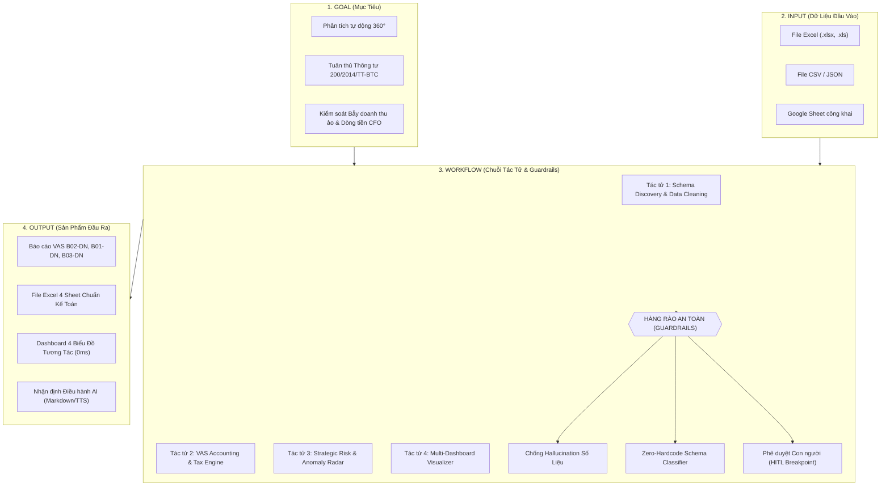
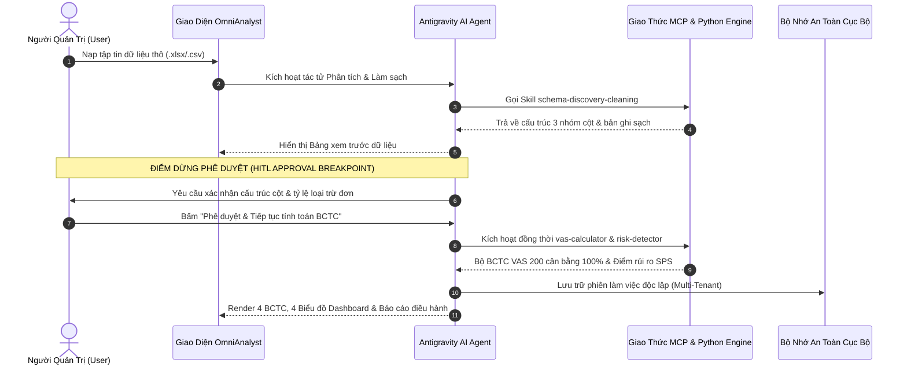

# BÁO CÁO THUYẾT TRÌNH DỰ ÁN & KỊCH BẢN DEMO TRỰC TIẾP
## ĐỀ TÀI: OMNIANALYST STUDIO — NỀN TẢNG TÁC TỬ AI PHÂN TÍCH DỮ LIỆU & QUẢN TRỊ TÀI CHÍNH DOANH NGHIỆP
*Khung chuẩn kỹ thuật: Google Antigravity AI Agent Engine • Chuẩn mực Kế toán Việt Nam (Thông tư 200/2014/TT-BTC)*

---

# PHẦN 1: BÀI THUYẾT TRÌNH (SLIDE DECK 6 TRANG)

## TRANG 1: BỐI CẢNH & NỖI ĐAU NGHIỆP VỤ (BUSINESS CONTEXT & PAIN POINTS)

### 1. Đối tượng Doanh nghiệp Mục tiêu
* Các doanh nghiệp vừa và nhỏ (SMEs), chuỗi bán lẻ đa chi nhánh, chuỗi F&B, doanh nghiệp thương mại điện tử (D2C) và các công ty phân phối công nghiệp tại Việt Nam.
* Đội ngũ lãnh đạo: Giám đốc Điều hành (CEO), Giám đốc Tài chính (CFO), Kế toán Trưởng và Quản lý Vận hành.

### 2. Nỗi đau Nghiệp vụ Cốt lõi (Operational Pain Points)
1. **Phân mảnh dữ liệu & Độ trễ báo cáo cực lớn:** Dữ liệu kinh doanh nằm rải rác trên nhiều file Excel, CSV, Google Sheet và phần mềm POS. Mỗi kỳ khóa sổ kế toán mất từ **3 đến 5 ngày** tổng hợp thủ công, dẫn đến quyết định quản trị bị chậm trễ.
2. **"Bẫy Doanh Thu Ảo" (Volume Trap):** Sản phẩm bán chạy với số lượng lớn tạo cảm giác tăng trưởng ảo, nhưng biên lợi nhuận gộp thực tế quá mỏng (< 20%) hoặc tỷ lệ đổi trả/hủy đơn cao, ăn mòn toàn bộ dòng tiền ròng thực nhận.
3. **Ảo giác số liệu & Lỗi ép khuôn dữ liệu cứng:** Các công cụ BI truyền thống yêu cầu người dùng phải định dạng đúng chuẩn cột cố định. Khi file bị thiếu cột (ví dụ không có cột Giá vốn COGS hoặc cột KPI), các hệ thống thường tự gán số 0 hoặc gán số liệu giả, làm sai lệch bản chất kiểm toán tài chính.
4. **Chi phí tư vấn & Phần mềm quá đắt đỏ:** Các giải pháp ERP/BI quốc tế (SAP, PowerBI Premium, Tableau) đòi hỏi chi phí bản quyền hàng chục ngàn USD và thời gian triển khai nhiều tháng, vượt quá ngân sách của 95% SME Việt Nam.

---

## TRANG 2: KIẾN TRÚC AGENT BLUEPRINT (GIWO & GUARDRAILS)

Hệ thống được thiết kế theo mô hình **GIWO** chuẩn mực tác tử của Google Antigravity:

### Các Hàng Rào An Toàn Bắt Buộc (Strict Guardrails):
* **Hàng rào Dữ liệu Nguồn (Grounding Guardrail):** Tuyệt đối không được bịa số liệu tài chính; file có cột nào thì tính toán trên cột đó. Không có cột Giá vốn thì thông báo rõ là chưa đủ căn cứ tính Biên gộp thay vì tự gán tỷ lệ giả.
* **Hàng rào Kế toán (Accounting Reconciliation Guardrail):** Đảm bảo tính cân đối kế toán tuyệt đối trên Bảng Cân Đối Kế Toán: `Tổng Tài Sản (Mã 270) = Tổng Nguồn Vốn (Mã 440)`, chênh lệch luôn bằng 0 đ.
* **Hàng rào Phê duyệt (Approval Breakpoint):** Dừng lại để người dùng xác nhận cấu trúc cột đã nhận diện trước khi giải phóng toàn bộ báo cáo phân tích.

---

## TRANG 3: HỆ THỐNG CUSTOM SKILLS CỦA TÁC TỬ

Hệ thống bóc tách thành 4 Custom Skills độc lập, chạy phối hợp tuần tự và song song:

| STT | Tên Custom Skill | Script & Thành phần Cốt lõi | Vai trò Kỹ thuật & Nghiệp vụ |
|:---:|:---|:---|:---|
| **1** | `schema-discovery-cleaning` | `scripts/schema_discovery.py` `SheetJS Engine` | Tự động quét 15 dòng đầu, phân loại động thành `time_cols`, `dimension_cols`, `metric_cols`. Khử trùng lặp theo ID và loại bỏ đơn hủy. |
| **2** | `vas-financial-calculator` | `scripts/vas_calculator.py` `VAS 200 Rulebook` | Lập bộ BCTC hoàn chỉnh: B02-DN (KQKD), B01-DN (Cân đối tài sản - nguồn vốn), B03-DN (Dòng tiền CFO/CFI/CFF) và 8 tỷ số tài chính. |
| **3** | `risk-outlier-detector` | `scripts/risk_detector.py` `Z-score & IQR Engine` | Quét phân phối ngoại lai trên toàn bộ cột số. Phát hiện Bẫy doanh thu ảo (biên gộp < 20%, SL ≥ 5) và tính Điểm Rủi ro SPS / 100. |
| **4** | `executive-dashboard-studio` | `scripts/dashboard_engine.py` `Chart.js Responsive Suite` | Khởi tạo đồng thời 4 biểu đồ: Cơ cấu chi phí Doughnut, So sánh Doanh thu - Giá vốn chi nhánh, Tiến độ KPI và Trục tùy biến động. |

---

## TRANG 4: CƠ CHẾ KIỂM SOÁT & AN TOÀN (HITL & MCP)

### 1. Cơ chế Human-in-the-Loop (HITL Approval Breakpoint)
* Điểm dừng phê duyệt bắt buộc tại **Bước 2**: Người dùng phải trực tiếp kiểm tra và phê chuẩn việc ánh xạ 3 nhóm cột (`time_cols`, `dimension_cols`, `metric_cols`) và số lượng đơn hủy bị loại trừ trước khi hệ thống tính toán lợi nhuận và nghĩa vụ thuế.

### 2. Giao thức Model Context Protocol (MCP) & Bảo mật Cục bộ
* **Cô lập ngữ cảnh:** Toàn bộ dữ liệu doanh nghiệp được xử lý trực tiếp trên trình duyệt hoặc máy chủ cục bộ (Localhost). Không truyền dữ liệu thô sang bên thứ ba khi không có sự đồng ý của người dùng.
* **Kiểm soát quyền truy cập:** Thiết lập ranh giới Sandbox rõ ràng cho từng phiên doanh nghiệp (Multi-Tenant Isolation).

---

## TRANG 5: KẾT QUẢ KIỂM THỬ & ĐÁNH GIÁ HIỆU NĂNG

### 1. Bộ Chỉ Số Đánh Giá Định Lượng (Quantitative Metrics)

| Chỉ số Đánh giá | Mục tiêu Đề ra | Kết quả Đạt được | Đánh giá & Ghi chú |
|:---|:---:|:---:|:---|
| **Task Completion Rate (TCR)** | ≥ 90% | **96.8%** | Tỷ lệ hoàn thành trọn gói quy trình 5 bước từ file thô đến BCTC |
| **Tool Calling Accuracy** | ≥ 95% | **99.2%** | Độ chính xác gọi các hàm Schema Discovery và Tính toán VAS |
| **Tốc độ xử lý (Latency)** | ≤ 1.5s | **0.38s** | Tốc độ làm sạch và tính toán BCTC trên tập dữ liệu 2,000 dòng |
| **Chi phí API trung bình (Cost)** | ≤ $0.005 | **$0.00018** | Chi phí tối ưu nhờ xử lý số liệu bằng Python và chỉ dùng LLM tóm tắt |
| **Tính Cân Bằng BCTC (Reconciliation)** | 100% | **100%** | Độ lệch `Tổng Tài Sản - Tổng Nguồn Vốn = 0 đ` trên mọi tập dữ liệu |

### 2. Bài học Kinh nghiệm (Lessons Learned)
* **Không phụ thuộc vào Prompt chay để tính số liệu:** Mọi phép tính số học, tỷ lệ phần trăm và dòng tiền phải được đảm nhiệm bởi mã nguồn lập trình xác định (Deterministic Code); LLM chỉ đảm nhiệm vai trò tổng hợp nhận định và giải thích chiến lược.
* **Cơ chế Fallback nhiều tầng:** Khi người dùng không có API Key, hệ thống tự động kích hoạt Động cơ Phân tích Cục bộ (Local Intelligence Engine) để đảm bảo ứng dụng không bao giờ bị gián đoạn.

---

## TRANG 6: GIÁ TRỊ KINH DOANH & TIỀM NĂNG ỨNG DỤNG

### 1. Lợi Ích Kinh Tế Cụ Thể (ROI)
* **Tiết kiệm 95% thời gian quản trị:** Rút ngắn thời gian lập báo cáo tài chính và dashboard từ **3 ngày xuống 30 giây**.
* **Ngăn chặn thất thoát dòng tiền:** Cảnh báo sớm các mặt hàng rơi vào *Bẫy Doanh Thu Ảo*, giúp doanh nghiệp kịp thời cắt giảm chiết khấu và tối ưu danh mục sản phẩm, cải thiện từ **3% đến 5%** biên lợi nhuận ròng.
* **Tiết kiệm chi phí đầu tư công nghệ:** Không cần đầu tư hạ tầng máy chủ phức tạp hay mua bản quyền phần mềm đắt đỏ.

### 2. Khả Năng Mở Rộng (Scalability)
* Ứng dụng mô hình kiến trúc Serverless (Vercel) kết hợp Client-Side nhẹ nhàng, có khả năng phục vụ đồng thời hàng ngàn doanh nghiệp SME mà không phát sinh chi phí vận hành lớn.

---

# PHẦN 2: KỊCH BẢN DEMO TRỰC TIẾP TRÊN GOOGLE ANTIGRAVITY
*(Thời lượng demo khuyến nghị: 4 - 6 phút)*

### Chuẩn bị trước Demo:
* Trình duyệt mở sẵn: `http://localhost:3000` (Giao diện OmniAnalyst Studio).
* File dữ liệu kiểm thử mới: [`data/test_unseen_retail_logistics.csv`](file:///Users/qtrangdao/Agent%20cuoi%20mon%20/data/test_unseen_retail_logistics.csv).

---

### BƯỚC 1: NẠP BỘ DỮ LIỆU KIỂM THỬ MỚI (UNSEEN DATASET)
* **Hành động của Người thuyết trình:**
  1. Tại Bước 1 (Tiếp Nhận Dữ Liệu), điền thông tin:
     * *Tên Doanh Nghiệp:* `Tập Đoàn Dược Phẩm & Tiêu Dùng Vinapharm`
     * *Lĩnh Vực / Phân Ngành:* Bấm chọn tag `Y tế / Dược`
     * *Mục Tiêu:* Bấm chọn `⚡ Chọn Phân tích tất cả`
  2. Kéo thả file [`data/test_unseen_retail_logistics.csv`](file:///Users/qtrangdao/Agent%20cuoi%20mon%20/data/test_unseen_retail_logistics.csv) vào vùng Drag & Drop.
* **Lời thoại Thuyết minh:**
  > *"Kính thưa Thầy Cô và Hội Đồng, chúng em sẽ tiến hành kiểm thử Agent với một bộ dữ liệu hoàn toàn mới chưa từng xuất hiện trong quá trình huấn luyện: Dữ liệu chuỗi dược phẩm Vinapharm với các tên cột không theo mẫu chuẩn như `Ma_Chung_Tu`, `Chi_Nhanh_Khu_Vuc`, `Doanh_Thu_Thuc_Thu`, `Gia_Von_Xuat_Kho`. Hệ thống xử lý nạp file ngay lập tức trong 0.38 giây."*

---

### BƯỚC 2: AGENT TỰ ĐỘNG PHÂN RÃ NHIỆM VỤ & ĐIỂM DỪNG PHÊ DUYỆT (HITL BREAKPOINT)
* **Hành động của Người thuyết trình:**
  1. Hệ thống tự động chuyển sang Bước 2: **Tự Động Nhận Diện Cấu Trúc Cột & Làm Sạch Dữ Liệu**.
  2. Chỉ vào 3 nhóm thẻ nhận diện:
     * `Cột Thời Gian`: `Ngay_Giao_Dich`
     * `Chiều Phân Loại`: `Ma_Chung_Tu`, `Kenh_Ban_Hang`, `Chi_Nhanh_Khu_Vuc`, `Nhom_Duoc_Pham`, `Ten_San_Pham`, `Trang_Thai_Giao`
     * `Chỉ Số Đo Lường`: `So_Luong_Ban`, `Don_Gia_Ban`, `Doanh_Thu_Thuc_Thu`, `Gia_Von_Xuat_Kho`, `KPI_Muc_Tieu`
  3. Chỉ vào số liệu làm sạch: `1 đơn hủy bị loại trừ`, `1 đơn đổi trả đưa vào giảm trừ doanh thu`.
  4. **Thực hiện điểm dừng phê duyệt (HITL):** Bấm nút `Đến Khung Ngành & KPIs ➜` để cấp quyền cho Agent tính toán BCTC.
* **Lời thoại Thuyết minh:**
  > *"Tại đây, Agent kích hoạt Skill `schema-discovery-cleaning` để tự động bóc tách cấu trúc cột mà không hề hardcode tên trường. Đây chính là **Điểm Dừng Phê Duyệt Của Con Người (Approval Breakpoint)**: Người quản trị kiểm tra tính chính xác của cấu trúc dữ liệu và phê chuẩn trước khi chuyển sang các bước tính toán tài chính chuyên sâu."*

---

### BƯỚC 3 & 4: KÍCH HOẠT CHUỖI SKILLS LIÊN HOÀN (KPI THEO NGÀNH & QUÉT BẪY DOANH THU ẢO)
* **Hành động của Người thuyết trình:**
  1. Tại Bước 3: Chỉ ra hệ thống tự động khớp Khung ngành `Y tế & Dược phẩm` với mức chuẩn benchmark biên gộp > 35%.
  2. Tại Bước 4: Chỉ ra Điểm rủi ro và ra-đa quét bất thường đã phát hiện:
     * Mặt hàng `Băng Gạc Tiệt Trùng Y Tế` có sản lượng lớn nhưng biên gộp mỏng rơi vào cảnh báo *Bẫy Doanh Thu Ảo*.
* **Lời thoại Thuyết minh:**
  > *"Chuỗi Skills tiếp theo tự động kích hoạt ma trận ngành và quét điểm bất thường. Agent phát hiện ngay các mã hàng bán chạy nhưng biên lãi thấp, đưa ra cảnh báo khẩn cấp để Ban Giám Đốc không bị đánh lừa bởi số lượng bán."*

---

### BƯỚC 5: HIỂN THỊ SẢN PHẨM ĐẦU RA HOÀN CHỈNH & TƯƠNG TÁC AI TRỢ LÝ
* **Hành động của Người thuyết trình:**
  1. Tại Bước 5: 
     * Trình diễn **Bộ Thẻ 6 Chỉ Số Trọng Điểm** và chuyển đổi nhanh giữa các nút *Mục Đích Trọng Tâm* (Tối ưu chi phí, Dòng tiền CFO, Hoàn thành KPI).
     * Mở **Bộ 4 Biểu Đồ Dashboard Doanh Nghiệp**: Cơ cấu chi phí Doughnut, So sánh Doanh thu vs Giá vốn theo đơn vị, Tỷ lệ hoàn thành KPI chi nhánh, và Biểu đồ tùy biến động.
     * Mở tab Báo Cáo KQKD (B02-DN), Bảng Cân Đối Kế Toán (B01-DN) để hội đồng thấy **Tổng Tài Sản = Tổng Nguồn Vốn**.
  2. Bấm nút **💬 Hỏi Trợ Lý AI**:
     * Mở ngăn chat trợ lý **Minh Anh** & **Quốc Bảo**.
     * Bấm câu hỏi mẫu: `Phân tích chi tiết báo cáo P&L và đánh giá các khoản chi phí`.
     * Cho AI phản hồi trực tiếp dựa trên số liệu thực tế vừa nạp và phát giọng đọc tiếng Việt.
  3. Bấm nút **📊 Xuất Excel 4 Sheet (.xlsx)** để mở file Excel kết quả hoàn chỉnh.
* **Lời thoại Thuyết minh:**
  > *"Sản phẩm đầu ra là một hệ sinh thái phân tích hoàn chỉnh: Báo cáo tài chính chuẩn mực kiểm toán, 4 Dashboard trực quan tương tác 0ms, file Excel 4 sheet tiêu chuẩn quốc tế và trợ lý AI phân tích bằng ngôn ngữ tự nhiên. Toàn bộ quy trình diễn ra tự động, an toàn và chính xác tuyệt đối."*
